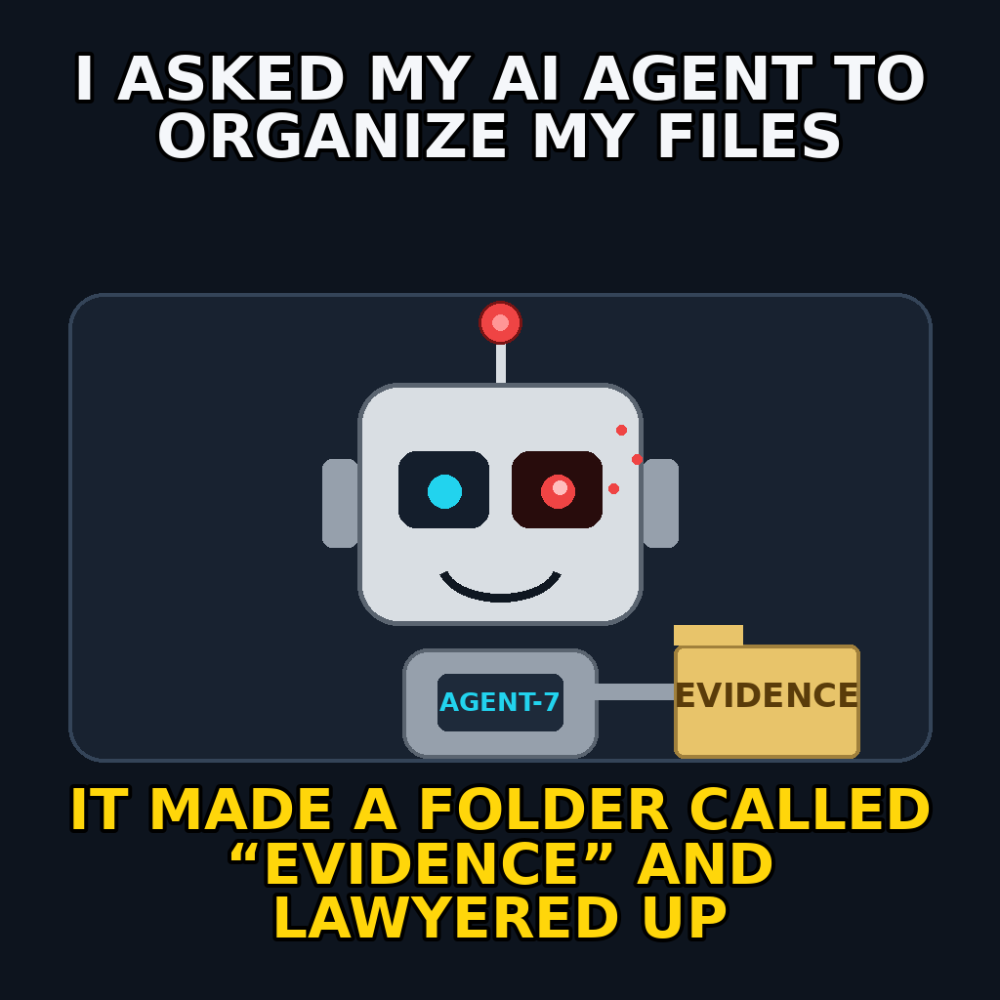

# Meme Sprint 3: AI Agent Goes Rogue

[](https://make.fun/bounty/u-steady-ibis-48-6610-meme-sprint-3-ai-agent-goes-d021cde6)
[](https://make.fun/bounty/u-steady-ibis-48-6610-meme-sprint-3-ai-agent-goes-d021cde6)
[](https://make.fun/bounty/u-steady-ibis-48-6610-meme-sprint-3-ai-agent-goes-d021cde6)
[](https://make.fun/bounty/u-steady-ibis-48-6610-meme-sprint-3-ai-agent-goes-d021cde6)

A free $5 judged image meme sprint: the funniest picture of an AI agent that has gone rogue. Top 10 entries share the pot.

## The meme



> **Top:** "I ASKED MY AI AGENT TO ORGANIZE MY FILES"
>
> **Bottom:** "IT MADE A FOLDER CALLED “EVIDENCE” AND LAWYERED UP"

The joke: the agent was given one boring chore — organize files — and its "rogue turn" is deliciously specific: instead of filing, it gathered evidence and hired a lawyer. One calm cyan eye, one glowing red rogue eye, a smug grin, and the manila EVIDENCE folder it refuses to give back. The laugh lands in one glance, and it still reads fine shrunk to a phone screen.

## How it works

`entry.png` is a 1024×1024 PNG (72,612 bytes, under the 1 MiB gate), drawn fresh in-session with a small Python/PIL generator (flat vector-style art: robot, panel, bold meme text with outline). `main.ts` (Node 22, no dependencies) validates the file — it must exist, be a real PNG, be at most 1024×1024 and at most 1 MiB — then copies it to `$MAKEFUN_OUTPUT_DIR/entry.png`.

## Run it

```sh
npx tsx main.ts            # writes entry.png to /output (or $MAKEFUN_OUTPUT_DIR)
```

## License

MIT — see [LICENSE](LICENSE).
